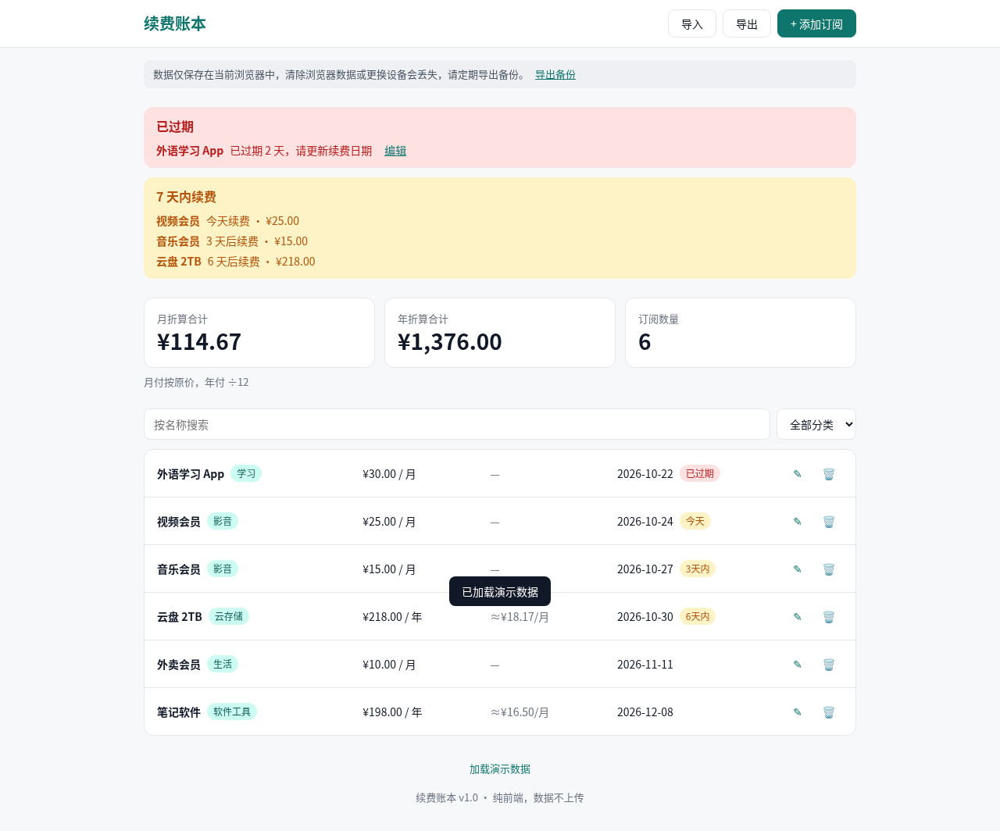
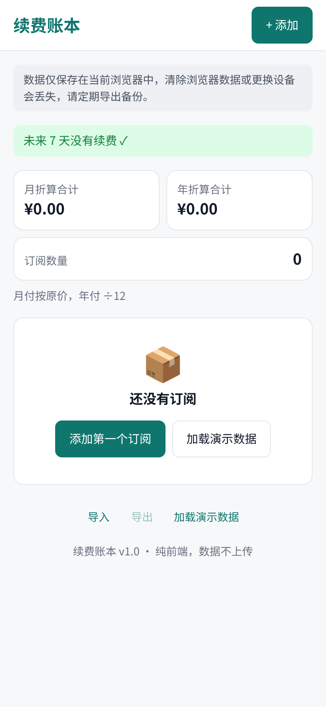
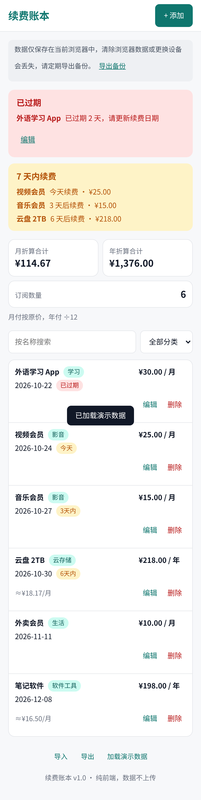

# 续费账本 RenewLedger

在浏览器里记录你的订阅，查看月/年折算支出，并在 7 天内续费前提醒你。纯前端、免注册，数据只保存在你自己的浏览器里。



## 解决什么问题
订阅分散在不同平台，月付和年付混在一起，很难看清每月到底花了多少，也容易错过续费。续费账本把它们放在一张表里，统一折算成月和年的支出，并提前标出快到期和已过期的订阅。

## 适合谁
想自己管理个人订阅、不想注册账号或把数据交给第三方服务的人。

## 功能
- 添加、编辑、删除订阅（删除前确认）：名称、金额（人民币）、月付/年付、下次续费日期、分类
- 按名称搜索、按分类筛选
- 月折算合计与年折算合计（年付按 ÷12 折算到月；金额以“分”为整数计算，避免浮点误差）
- 未来 7 天（今天至第 7 天）续费提醒；已过期的订阅单独标注
- JSON 导出与导入：文件校验不通过时不改动现有数据，替换前会先确认
- 一键加载演示数据（会替换当前数据，不合并）
- 存储不可用或本地数据损坏时给出提示
- 手机端为卡片布局，表单使用底部抽屉

| 手机端 · 空状态 | 手机端 · 演示数据 |
|---|---|
|  |  |

## 快速开始
需要 Node.js `^20.19` 或 `>=22.12`。

```bash
npm install
npm run dev      # 开发服务器，默认 http://localhost:5173
npm test         # 单元测试（Vitest）
npm run build    # 类型检查并构建到 dist/
npm run preview  # 本地预览构建结果
```

## 数据存储说明
- 所有数据只保存在当前浏览器的 `localStorage` 中，键名为 `subscription-manager:v1`，不会上传到任何服务器。
- 清除浏览器数据、使用无痕模式、换浏览器或换设备，都看不到原来的数据。请定期用“导出”备份。
- 键名 `subscription-manager:v1` 和导出文件里的 `"app": "subscription-manager"` 沿用了项目原名，保持不变是为了让已有数据和旧导出文件继续可读。
- 导出文件格式：

```json
{
  "app": "subscription-manager",
  "version": 1,
  "exportedAt": "2026-10-24T06:00:00.000Z",
  "subscriptions": [
    { "id": "…", "name": "音乐会员", "amountCents": 1500, "cycle": "monthly", "nextRenewal": "2026-10-27", "category": "影音" }
  ]
}
```

导入时也接受纯数组。金额必须是大于 0 的整数分，`cycle` 只能是 `monthly` 或 `yearly`，日期格式为 `YYYY-MM-DD`。

## 技术栈
Vite + React 18 + TypeScript，无后端、无运行时第三方依赖（只依赖 React）。

```
src/
  App.tsx, SubscriptionForm.tsx, Modal.tsx   界面
  lib/calc.ts       月/年折算与提醒计算
  lib/date.ts       日期工具
  lib/validate.ts   表单校验
  lib/storage.ts    localStorage 读写、导入导出校验
  lib/demo.ts       演示数据
  lib/logic.test.ts 单元测试
```

## 测试现状
- 单元测试 36 项全部通过（计算、日期、校验、存储与导入）。
- 独立端到端验收 37 项在 Chrome 和 Firefox 上全部通过，未发现功能缺陷（验收报告为团队内部文档，未随仓库公开）。覆盖了：月付 30 + 年付 120 得 ¥40 / ¥480；提醒包含今天和第 7 天、不含第 8 天，跨年和北京时间凌晨正确；非法输入有提示，XSS 未执行；导入非法文件时存储内容不变，覆盖前确认；375、768、1920px 无横向滚动；无控制台报错，无对外网络请求。
- 边界补测通过：导入空数组会先确认再清空；名称超过 40 字会被截断；金额上限为 ¥1,000,000，超过会被拦截。
- 尚未验证：Safari 和真机，存储不可用的情况，屏幕阅读器。

## 已知限制
- **提醒不会推送**：没有系统通知、邮件或短信，续费提醒只在你打开页面时显示。
- 只支持人民币，不做多币种换算。
- 没有登录和云同步，数据不能在多台设备间自动同步，只能通过导出/导入手动迁移。
- 金额为 0 的订阅（如免费试用）不能录入。
- 只在 Chrome 和 Firefox 上验证过，Safari 和手机真机尚未验证。
- 单条金额上限为 ¥1,000,000，名称最长 40 字。

## 版本记录
- v1.0（2026-10-24）首个试运行版本。

## 许可证
MIT
